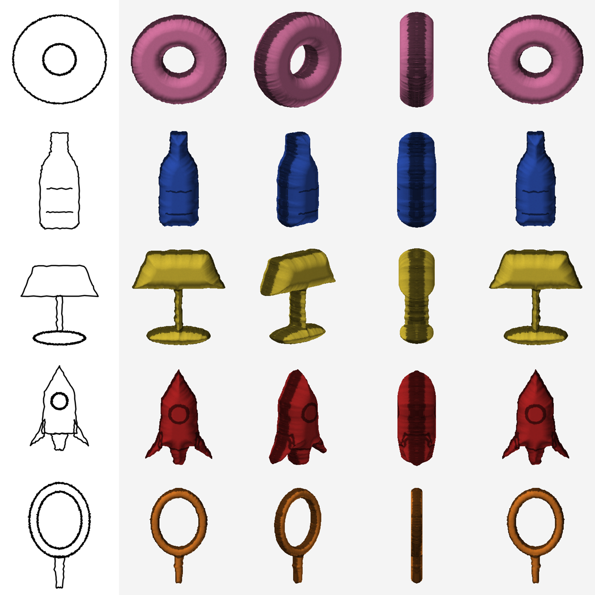

# Sketch2Shape AI — from a 2D sketch to a textured 3D asset

TechZephyr 4.0 · IIT Bhubaneswar · Computer Vision & Generative AI hackathon submission

Draw a sketch (or upload a JPG/PNG), optionally add a text prompt, and export a textured `.glb` and `.obj`.
The always-available CPU backend creates a closed 3D silhouette-inflation mesh; it is **not** a learned reconstruction
and does not infer hidden object structure. Learned image-to-3D models are separate optional backends with substantially
higher VRAM requirements.

**This machine (RTX 3050 Laptop, 4 GB VRAM):** CUDA/PyTorch works, but the learned backends in this repository do not
fit the documented GPU requirements. The app deliberately uses the CPU silhouette backend by default. TripoSR, a
potential pretrained image-to-3D backend, requires about 6 GB VRAM and a 1.68 GB checkpoint; it is not installed or
downloaded here. Do not describe the default result as AI-generated full-object reconstruction.


*Left: input sketch. Right: four views of the exported `.glb`, rendered by `scripts/render_preview.py` (software renderer, no GPU).*

---

## 1. Why this design

| Problem in the brief | What we do |
|---|---|
| "Judges must be able to reproduce it" | The pipeline has a **CPU backend that always works** (`inflate`), plus automatic fallback. A missing GPU model never means "no output". |
| "Stay related to the sketch, not just the prompt" | Sketch → ControlNet scribble condition, **N candidates re-ranked by silhouette-IoU with the sketch**, and a **geometry guard**: if the generated image drifted, the sketch's own silhouette drives the geometry. |
| "Real 3D, not a flat plane" | Mesh validator rejects flat/empty/NaN meshes; reports watertightness, Euler characteristic, depth ratio. |
| "Report time, hardware, limitations" | Every run writes `run_report.md/json` automatically (stage timings, GPU/CPU/RAM, models used, validation, notes). |
| "Prompt optional" | Prompt is never required: structure descriptors (tall/wide, symmetric, N through-holes) are derived from the sketch itself, and an optional Claude call can name the object. |

### What is new vs. the three reference repos we studied
| Source repo (supplied) | Idea we reused | What we added |
|---|---|---|
| `sample-retail-sketch-to-3d` (AWS, MIT-0) | sketch cleanup → sketch-to-image → background removal → image-to-3D (TRELLIS) → GLB; optional LLM captioning | Runs **locally, no AWS**; CPU fallback; fidelity re-ranking; validation + reports; no cloud cost |
| `Sketch-to-3d-Model` (Hofer thesis) | flood-fill silhouette, Euler-number topology (genus), IoU evaluation | Re-implemented (vectorised, independent code) and **turned into a product feature**: through-hole detection (`--holes nested`), the CPU **sketch-inflation** reconstruction, and silhouette-IoU as a runtime quality score |
| `stable-dreamfusion` (Apache-2.0) | Zero-1-to-3 SDS image-to-3D | Bundled in `third_party/` as an optional **"hero asset" backend** (slow, high fidelity) behind the same interface |

**New concepts not present in any of them:** (1) tiered auto-fallback reconstruction; (2) CPU sketch inflation with watertight
side-walls, Taubin smoothing and projected texture; (3) sketch-fidelity re-ranking + drift guard; (4) offline texture stylizer
(prompt colour/material words + AO + the user's own pencil lines); (5) self-validating exports with a no-dependency GLB writer/reader;
(6) auto-generated run reports.

---

## 2. Quick start

### A. Windows (Python 3.12)
```bash
cd C:\Users\ASUS\Downloads\Sketch2Shape_AI\sketch2shape
py -3.12 -m venv .venv
.venv\Scripts\python.exe -m pip install --upgrade pip setuptools wheel
.venv\Scripts\python.exe -m pip install -r requirements.txt
.venv\Scripts\python.exe scripts\check_env.py
.venv\Scripts\python.exe tests\test_pipeline.py
run.bat                           # -> http://127.0.0.1:7860
```

The workspace selects `sketch2shape/.venv` for VS Code. For PowerShell, activate with
`.\.venv\Scripts\Activate.ps1`; if script execution is restricted, use the `.venv\Scripts\python.exe` path as above.
The launcher uses the existing environment and does not install or download model weights.

### B. Optional GPU packages / model backends
```bash
.venv\Scripts\python.exe -m pip install torch==2.11.0+cu128 --index-url https://download.pytorch.org/whl/cu128
.venv\Scripts\python.exe -m pip install -r requirements-gpu.txt
.venv\Scripts\python.exe scripts\check_env.py
```
PyTorch CUDA was tested on this RTX 3050 Laptop with CUDA 12.8 wheels and the installed NVIDIA driver. CUDA tensor
operations work, but that does not make a larger 3D model fit. TRELLIS documents a 16 GB minimum; TripoSR documents
about 6 GB. This 4 GB GPU is below both. Check each upstream model's current requirements and checkpoint size before
installing; weights are never downloaded by the app without an explicit request. Optional Anthropic captioning sends
the sketch image to that external service only when deliberately enabled.

### C. Command line
```bash
python -m sketch2shape.cli samples/inputs/donut.png --prompt "pink glazed donut" --holes nested
python -m sketch2shape.cli my_sketch.jpg --backend trellis --generator sd_controlnet --candidates 4
```
Outputs land in `outputs/<run>/`: `<run>.glb`, `<run>.obj` (+`.mtl`, `_texture.png`), intermediate images, `run_report.md`.

---

## 3. Pipeline

```
 draw / upload ─► 1 preprocess ─► 2 sketch analysis ─► 3 sketch-guided image ─► 4 matte + rank ─► 5 image→3D ─► 6 validate ─► export
 (+ optional       polarity,        silhouette, holes   SD1.5 + ControlNet     rembg / flood-fill   TRELLIS │          GLB-reader      .glb .obj
   prompt)         CLAHE-style      (Euler), symmetry,  scribble, N candidates, + IoU(sketch) pick   InstantMesh │      watertight?      + report
                   threshold,       aspect → prompt     (GPU only)             + drift guard         DreamFusion │      depth ratio?
                   crop, scribble   descriptors                                                      ─ fallback ─┴► inflate (CPU, always)
```

| Backend | Hardware | Output | Typical use |
|---|---|---|---|
| `inflate` (default fallback) | CPU | watertight 2.5D silhouette-inflation solid, projected texture | offline fallback; not learned reconstruction |
| `trellis` | CUDA, ≥16 GB VRAM | learned textured 3D mesh | not suitable for this 4 GB GPU |
| `instantmesh` | CUDA and upstream dependencies | learned textured OBJ → converted to GLB | optional, not installed or tested here |
| TripoSR | CUDA, about 6 GB VRAM | learned single-image 3D mesh | candidate only; not integrated or downloaded |
| `dreamfusion` | CUDA, 10–40 min | SDS-optimised mesh | one hero asset, not live demos |

`--backend auto` picks TRELLIS if configured, else `inflate`. A requested backend that fails falls back to `inflate`
and the reason is written to the run report.

---

## 4. Results, timing, hardware (measured)

Measured in the authoring sandbox: **1 CPU thread, 3.9 GB RAM, no GPU**, Python 3.12, backend `inflate`, offline stylizer.
Reproduce with `python scripts/make_samples.py` (fresh numbers land in `samples/outputs/*/run_report.md`).

| Sample | Total time | Faces | Watertight | Sketch silhouette IoU | Through-holes |
|---|---|---|---|---|---|
| donut | 3.05 s | 133k | yes | 0.989 | 1 |
| bottle | 2.21 s | 67k | yes | 0.978 | 0 |
| lamp | 2.47 s | 87k | yes | 0.973 | 0 |
| rocket | 1.90 s | 61k | yes | 0.973 | 0 |
| tennis racket | 1.23 s | 37k | yes | 0.939 | 1 |

GPU timings (SD+ControlNet, TRELLIS) were **not measured by us** — no GPU was available while building. Each run records its own
numbers in `run_report.md`; paste yours here after your first GPU run:

| Machine | Generator | 3D backend | Total time |
|---|---|---|---|
| _fill in_ | | | |

Example artefacts: `samples/outputs/<name>/<name>.glb|.obj`, inputs in `samples/inputs/`.

---

## 5. Validation status (honest)

| Component | Status |
|---|---|
| Preprocess, silhouette/topology, CPU inflation, GLB/OBJ export, validator, fidelity score, CLI, reports | **Run and tested** (11 automated tests in Python 3.12) |
| Diffusion branch *logic* (candidate ranking, drift guard, failure fallback) | Tested with mocked generator |
| Gradio UI (`app.py`) | Launched locally with Gradio 5; draw/upload controls render. Upload and drawing generation are being tested separately. |
| SD 1.5 + ControlNet, rembg, TRELLIS, InstantMesh, Stable-DreamFusion wrappers | **Written against the upstream APIs but not executed here** (no GPU / no internet). Treat as untested until `scripts/check_env.py` is green and you've done one GPU run. |

---

## 6. Limitations
* Single view cannot specify the back. `inflate` mirrors the front; GPU backends hallucinate plausibly.
* `inflate` is silhouette-driven 2.5D geometry (good for convex-ish objects, bottles, lamps, toys); it will not invent
  concavities, handles, or interior structure. Sibling enclosed regions (e.g. a mug handle's void) are not detected as holes in
  sketch-only mode; nested outlines (rings, frames, racket heads) are, via `--holes nested`. With the GPU path the matte of the
  generated image supplies true holes.
* A single-view learned image-to-3D backend is not currently functional on the tested 4 GB RTX 3050. A cloud service would
  require separate integration, disclosure that uploaded images leave the machine, and any required credentials or payment.
* Offline stylizer = flat colour from prompt words (+shading + your pencil lines); realistic materials need the diffusion path.
* Open outlines are closed heuristically (morphological closing, then convex hull); very messy sketches may need redrawing.
* Not intended for manufacturing-grade 3D printing (outside the brief's mandatory scope), though `inflate` meshes are watertight.
* SD 1.5 downloads ≈ 5 GB, ControlNet ≈ 1.4 GB, TRELLIS ≈ several GB on first run; diffusion on CPU is minutes per image, so `auto` disables it there.

## 7. Troubleshooting
| Symptom | Fix |
|---|---|
| `No strokes detected` | Draw darker / thicker lines; photo of paper: even lighting, fill the frame |
| Output is a puffy blob | Expected for `inflate`; use GPU backend, or lower `--depth-scale` (e.g. 0.6) |
| Ring/frame filled in | Use *Holes → nested* (or `--holes nested`) |
| `Backend 'trellis' unavailable` in report | `S2S_TRELLIS_DIR` unset / no CUDA → fell back to `inflate` (by design) |
| CUDA out of memory in generation | Pipeline automatically falls back to offline stylizer; or use ≥8 GB VRAM (<8 GB uses CPU offload) |
| Gradio 3D viewer blank | Open the `.glb` in Blender / https://gltf-viewer.donmccurdy.com |

## 8. Layout
```
app.py                    Gradio UI (draw / upload / prompt / 3D viewer / downloads)
sketch2shape/             preprocess · silhouette · analysis · generate · background · stylize
  backends/               inflate (CPU) · trellis · instantmesh · dreamfusion
  pipeline.py             orchestrator + fallbacks      validate.py  mesh checks + fidelity
  meshio.py               dependency-free GLB/OBJ IO    report.py    timings / hardware report
scripts/                  check_env.py · make_samples.py · render_preview.py
tests/test_pipeline.py    10 tests          samples/  inputs + generated outputs
docs/                     ARCHITECTURE.md · MODELS.md (disclosure) · DEMO_SCRIPT.md
third_party/              stable-dreamfusion (Apache-2.0, trimmed)
```
See `docs/MODELS.md` for the pretrained-model / external-service disclosure the rules require.
